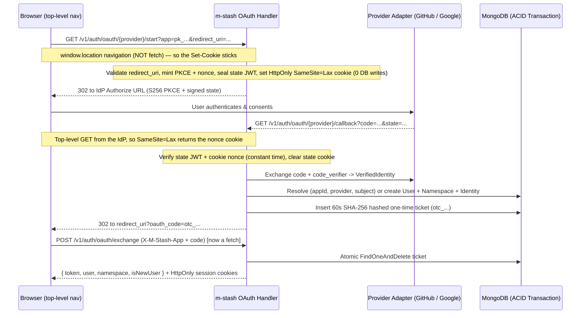

# The Three-Method Wall

*How we added GitHub and Google OAuth2 + PKCE to m-stash — without letting OAuth inside the building.*

---

Every backend eventually hits the same Tuesday afternoon.

You already have email-and-password signup working. Users get accounts, sessions, and private data. Everything is clean, small, and easy to reason about. Then somebody asks the most reasonable question in software:

> "Can we add Sign in with GitHub and Google?"

On the surface, it sounds like an afternoon's work. Grab an OAuth library, wire up two callback URLs, look up the user by email, call it a day.

In practice, this is the exact moment small backends turn into haunted houses.

Within a week, you are storing provider access tokens you never needed, leaking long-lived JWTs into browser history and proxy logs, silently letting attackers hijack password accounts through unverified email merges, accidentally turning wildcard dev CORS into an open redirector, and building an AES-GCM secret-encryption subsystem in MongoDB so every tenant can paste their own OAuth client secret into a form.

When we decided to bring social login to **m-stash**, we started with the same rule that governs the rest of the project:

> **Make the insecure version inexpressible.**

To do that, we had to ask a different question. Not *"How do we integrate OAuth into m-stash?"* — but *"How small can we make the room where OAuth is allowed to live?"*

---

## Act I: Separate Proof From Recognition

Look at what happens after a user signs in to m-stash.

They create private records in `/v1/me/resources/{type}`. They publish a portfolio at `/{username}/record/welcome`. They read shared app data. Their writes emit transactional outbox events to webhooks. Their app stays isolated from every other tenant on the deployment, bounded by its plan quotas.

Now look at what *all* of that downstream machinery actually reads from a request:

```go
type Claims struct {
    UID   string `json:"uid"`
    Email string `json:"email"`
    Role  string `json:"role"`
    AppID string `json:"appId"`
    jwt.RegisteredClaims
}
```

Four fields. That's it.

The namespace layer does not care whether you typed a 14-character password, tapped a GitHub button, or signed in with Google. The visibility rules do not care. The outbox does not care. The quota engine does not care.

That was the first big unlock: **authentication has two distinct halves — *proof* and *recognition*.**

- **Proof** is how a human convinces the server who they are (a bcrypt hash, a GitHub authorization code, a Google OIDC exchange).
- **Recognition** is how the rest of the system knows who is knocking (an m-stash JWT and its paired HttpOnly browser session cookies).

When those two halves stay fused together, every new login method bleeds across your entire codebase. When you split them cleanly, OAuth stops being an architecture change and becomes a **three-method wall**:

```go
type VerifiedIdentity struct {
    Provider      string
    Subject       string
    Email         string
    EmailVerified bool
    DisplayName   string
    AvatarURL     string
    UsernameHint  string
}

type OAuthAdapter interface {
    Name() string
    AuthorizeURL(callbackURL, state, codeChallenge string) string
    Exchange(ctx context.Context, callbackURL, code, codeVerifier string) (VerifiedIdentity, error)
}
```

Everything external stays on the far side of `OAuthAdapter`. An adapter's entire job in life is to build an authorize URL and trade an authorization code plus PKCE verifier for a `VerifiedIdentity`. It never touches MongoDB. It never mints a JWT. It never sets a cookie. It never decides whether two accounts should be linked.

And on the near side of the wall, m-stash takes that `VerifiedIdentity`, resolves or provisions a normal `User` + personal `Namespace`, and hands it off to the *exact same* `generateJWT` and `issueBrowserSession` functions password login has used since day one.

Not a single line of resource, namespace, visibility, webhook, or outbox code had to change.

---

## Act II: Choreography With Zero Wasted Moving Parts

Once the wall was drawn, we walked the full browser journey step by step and asked, at every arrow: *"What could fail here? What could an attacker forge, replay, steal, or exhaust?"*

Here is the flow that survived that interrogation. Note the one detail that makes the whole thing work: `/start` is a **top-level browser navigation** (`window.location`), not a `fetch` — which is precisely why the `SameSite=Lax` cookie survives the round trip through GitHub and Google.



Every piece of that diagram earned its place the hard way.

### 1. Zero OAuth secrets in MongoDB

A tempting early question in a multi-tenant BaaS is: *"Should every app store its own GitHub/Google client secret in MongoDB?"*

Think about what saying "yes" actually buys you — and what it costs. Storing third-party client secrets in your primary database forces you to introduce envelope encryption, master key rotation, secret redaction across admin/builder APIs, and per-tenant callback URL gymnastics. Worse, every ephemeral vibe sandbox suddenly can't use social login until the developer goes to Google Cloud Console and configures an OAuth consent screen.

Instead, m-stash keeps OAuth credentials **strictly in deployment environment variables** (`GITHUB_CLIENT_ID`/`SECRET`, `GOOGLE_CLIENT_ID`/`SECRET`). Callback URLs are deployment-canonical:

```text
{PUBLIC_BASE_URL}/v1/auth/oauth/github/callback
{PUBLIC_BASE_URL}/v1/auth/oauth/google/callback
```

Register your deployment once with GitHub and Google, and **every app and every sandbox** on that deployment immediately gets social login — while MongoDB holds zero third-party secrets.

### 2. Stateless `/start` with Login-CSRF and PKCE built in

Most OAuth implementations insert a row into an `oauth_states` table on `/start`. That means an unauthenticated `GET` endpoint can be spammed to fill your database with junk state rows.

We do **zero database writes** on `/start`.

Instead, m-stash generates a 32-byte PKCE `code_verifier` and a 16-byte random `nonce`, seals `{nonce, appId, provider, redirectUri, verifier, linkUserId}` inside a 5-minute HS256 JWT, and pairs it with an `HttpOnly`, `SameSite=Lax` cookie scoped strictly to `Path=/v1/auth/oauth` carrying that same `nonce`.

When the provider calls back:
- The state JWT signature, issuer, audience, and expiry must verify.
- The state's `provider` must match the callback URL's `{provider}` segment.
- The `m_stash_oauth` cookie must exist and match `state.Nonce` in constant time (`subtle.ConstantTimeCompare`).
- The cookie is cleared immediately, win or lose.

An attacker who initiates an OAuth login on their own machine and tricks a victim into visiting the callback URL cannot pass the check — the victim's browser does not hold the attacker's `HttpOnly` nonce cookie. Login-CSRF dies on contact, and `/start` costs zero database writes.

### 3. No JWT ever touches a URL

Putting `?token=eyJhbGci...` in a redirect URL is the oldest OAuth footgun on the web. URLs get cached in browser history, echoed in server access logs, leaked in `Referer` headers to third-party scripts, and pasted into Slack screenshots by users asking for help.

So the callback redirect **never carries a JWT**. Instead, m-stash mints a 32-byte random ticket prefixed with `otc_`, stores only its **SHA-256 hash** in `_m_stash_oauth_tickets` with a 60-second MongoDB TTL index, and redirects to `redirect_uri?oauth_code=otc_...`.

Back in the SPA, the login page immediately scrubs the query string via `window.history.replaceState` and posts `{ code }` to `POST /v1/auth/oauth/exchange` with its `X-M-Stash-App` key. The server consumes the ticket in a single atomic operation:

```go
func (app *application) consumeOAuthTicket(ctx context.Context, record *AppRecord, token string) (oauthTicket, error) {
    var ticket oauthTicket
    err := app.database.Collection(oauthTicketCollectionName).FindOneAndDelete(
        ctx,
        bson.M{"tokenHash": hashOAuthTicket(token), "appId": record.ID},
    ).Decode(&ticket)
    if err != nil {
        return oauthTicket{}, err
    }
    if time.Now().UTC().After(ticket.ExpiresAt) {
        return oauthTicket{}, mongo.ErrNoDocuments
    }
    return ticket, nil
}
```

Four guarantees fall out of those twelve lines:

- **Single-use by atomicity:** two concurrent requests racing with the same `otc_` code can never both win `FindOneAndDelete`.
- **App-scoped:** a ticket minted for App A cannot be redeemed against App B — `appId` is part of the filter.
- **Short-lived:** even if abandoned, it expires in 60 seconds and MongoDB's TTL reaper sweeps it away.
- **Hash-only at rest:** we store `sha256(ticket)`, so read access to the collection cannot forge a live ticket.

And what comes back from `/v1/auth/oauth/exchange`? The exact same `{ token, user, namespace }` contract (plus `isNewUser` and HttpOnly session cookies) that `/v1/auth/signup` and `/v1/auth/login` already speak.

### 4. Atomic first-time provisioning on MongoDB

When someone clicks **Continue with GitHub** for the first time, they don't fill out a username form. They expect to land directly inside their workspace.

In `provisionExternalUser`, m-stash:
1. Enforces `effectiveLimits(record).MaxUsers` (so social login can never bypass sandbox or free-tier user caps).
2. Derives a clean personal namespace slug from the provider's `UsernameHint` (e.g., GitHub `login`) or email local-part, filtering out reserved slugs (including the newly reserved `oauth`) and non-ASCII characters.
3. Runs a `writeconcern.Majority()` MongoDB transaction that inserts **four** documents together — the password-less `User`, personal `Namespace`, owner `NamespaceMember`, and `UserIdentity` (plus the welcome record for non-sandbox apps).
4. If the desired slug is already taken, retries cleanly with a 4-character random hex suffix (`octocat-a3f1`) without ever leaving an orphaned user or dangling namespace behind.

### 5. Zero-dependency adapters

We didn't pull in an external OAuth SDK. Both built-in adapters — `githubOAuthAdapter` and `googleOAuthAdapter` — live in a single ~260-line file (`oauth_providers.go`) built purely on Go's standard library.

They share a dedicated outbound `oauthHTTPClient()` with a 10-second timeout, `CheckRedirect` disabled (an upstream token or userinfo endpoint answering with a `3xx` is an error, never a redirect to follow with a `client_secret` or bearer token), and every response body wrapped in `io.LimitReader(..., 64*1024)`.

Zero extra transitive dependencies. Zero hidden transport defaults. Every byte sent and received is visible in one screen.

---

## Act III: The Seams We Refused to Cross

Most OAuth bugs don't happen on the happy path. They happen at the seams — where OAuth meets passwords, where OAuth meets CORS, where OAuth meets multi-tenancy.

The sharpest seam of all: **account takeover by email matching.**

Because m-stash has no email transport, password signups are *unverified*. Think about what happens if an attacker signs up with `victim@company.com` + `attacker-password` before the victim ever visits your app — and then the victim clicks "Continue with Google" using `victim@company.com`. If your OAuth handler naively says *"oh, I found a user with that email, let me link Google to it!"*, the attacker still holds a working password to the victim's freshly Google-authenticated account.

So the resolution path draws a hard line — an unauthenticated OAuth login **never** adopts an account that has a password:

```go
// An account already owns this email address.
if err := users.FindOne(ctx, bson.M{"appId": record.ID, "email": verified.Email}).Decode(&existingUser); err == nil {
    // Password signups are unverified, so never silently adopt one.
    if existingUser.PasswordHash != "" {
        return User{}, false, errOAuthLinkRequired
    }
    // Safe: the existing account is itself OAuth-only (no password), so both
    // sides were proven by a trusted provider. Attach this identity.
    return existingUser, false, app.linkIdentity(ctx, record.ID, existingUser.ID, verified)
}
```

When `PasswordHash != ""`, the callback redirects with `oauth_error=account_exists_link_required`, telling the user to sign in with their password first and *explicitly* link the provider via `POST /v1/me/identities/start`. Auto-linking by verified email is allowed only when both identities were proven by trusted providers.

A few more seams we refused to cross:

- **External identity keys, not email keys.** Users change their email addresses on GitHub and Google. So `_m_stash_identities` keys every link by the immutable triple `{appId, provider, subject}` (GitHub's numeric user `id`, Google's OIDC `sub`), with a second unique index on `{userId, provider}`. Changing your GitHub email tomorrow will never lock you out or spawn a duplicate account.
- **The password-less timing oracle.** Making `User.PasswordHash` optional (`bson:"password,omitempty"`) introduces a subtle edge case in `handleLogin`: a `{ email, password: "" }` post against an OAuth-only user. We short-circuit `user.PasswordHash == ""`, but still run a constant-time dummy `bcrypt.CompareHashAndPassword` against a startup-generated hash at `bcryptCost = 12` — so response timing matches a real bcrypt check and can't enumerate which accounts are OAuth-only — then return the identical `401 Invalid email or password`.
- **The last-key lockout.** Authenticated users can inspect (`GET /v1/me/identities`), link (`POST /v1/me/identities/start`), and unlink (`DELETE /v1/me/identities/{provider}`) providers. Before deleting, the server counts remaining identities and checks `PasswordHash`. If removing that provider would leave a password-less user with zero ways back in, m-stash refuses with `409 Conflict`.

---

## Epilogue: The Architecture That Stays Boring

When you turn on GitHub or Google credentials in `.env`:
- `/.well-known/m-stash.json` advertises the enabled providers under `capabilities.oauth.providers`.
- `GET /v1/auth/providers` returns them for any client app.
- `/login` and `/signup` automatically render **Continue with GitHub** / **Continue with Google** buttons and handle `?oauth_code` handoff cleanly.
- The Operator Console at `/admin` lights up GitHub OAuth and Google OAuth posture indicators — booleans only, never a secret.
- And when you leave the env vars blank, the buttons disappear, the OAuth routes return `404`, and m-stash runs exactly as it did before.

Tomorrow, if we want Discord, Apple, Microsoft, or a custom enterprise OIDC adapter, we implement three methods on `OAuthAdapter` and register two env vars. Everything behind the wall — personal namespaces, shared scopes, visibility, quotas, webhooks, sandboxes — stays blissfully unaware.

That is what "future-proof" actually looks like: not a sprawling plugin framework, just a small, sharp boundary where complexity is not allowed to cross.

---

## Appendix: Five Subtle Traps Worth Calling Out

The main narrative covers the OAuth dangers on the critical path. These five are the ones that *aren't* — the quiet seams that bite teams weeks after "it works." Each is formatted as **The Trap → The Aha → The Enforcement**.

---

### 1. Cross-Audience JWT Confusion (Same Secret, Two Jobs)

- **The Trap:** Reusing `JWT_SECRET` to sign a short-lived OAuth `state` token — and accidentally making that `state` JWT valid as an `Authorization: Bearer` token against your API endpoints.
- **The Aha:** A shared HMAC signing key is only safe across token types when *every* verifier pins a distinct `aud` (audience) claim and rejects anything else.
- **The Enforcement:** OAuth state JWTs are minted with `Audience: ["m-stash-oauth-state"]`, while the API's `authenticate()` strictly enforces `jwt.WithAudience(JWTAudience)` plus `claims.UID != "" && claims.Subject == claims.UID`. We lock this in permanently with tests that verify in *both* directions: a state JWT cannot authenticate an API request, and a session JWT cannot forge an OAuth state.

---

### 2. Wildcard CORS Is Not a Wildcard Redirect

- **The Trap:** Reusing your CORS `ALLOWED_ORIGINS` check to validate `redirect_uri`. In local dev and ephemeral sandboxes, `ALLOWED_ORIGINS` is often `["*"]`. If `"*"` passes your redirect check, you just shipped an open redirector — and worse, one that appends `?oauth_code=otc_...` to `https://evil.example`.
- **The Aha:** CORS `*` means "any browser origin may read responses." Redirect allowlisting means "only these origins may receive a user's login handoff ticket." They are fundamentally different trust decisions that must never share a code path.
- **The Enforcement:** `validateOAuthRedirect` treats `"*"` as *never* matching external domains. A redirect is allowed only if its origin equals `publicBaseURL(r)`, matches an *explicit* non-wildcard entry in the app's or deployment's `AllowedOrigins`, or is `http://localhost` / `http://127.0.0.1` / `http://[::1]` when the app is a sandbox or uses wildcard dev origins.

---

### 3. GitHub's Public Profile Email Lie

- **The Trap:** Calling GitHub's `GET /user` endpoint and reading its `email` field as a verified identity claim. On GitHub, `GET /user` can return `null` (when a user keeps their email private) *or* an address whose verification status isn't surfaced there at all.
- **The Aha:** Never assume a provider's profile endpoint gives you a *verified* email. Check the provider's authoritative verification signal — and fail closed when it's missing.
- **The Enforcement:** The GitHub adapter requests `read:user user:email`, uses `/user` only for the immutable numeric `id` (`Subject`) and `login` (`UsernameHint`), and separately calls `/user/emails`, filtering strictly for `verified: true` (preferring `primary: true`). The Google adapter requires `email_verified: true` from OIDC `userinfo`. Any `VerifiedIdentity` with `EmailVerified == false` is rejected before provisioning.

---

### 4. Fail Boot Loud, Never Fail Silently

- **The Trap:** Treating a half-configured provider (`GITHUB_CLIENT_ID` set, `GITHUB_CLIENT_SECRET` blank from a typo in a `.env` file or dashboard) as "provider disabled." The deploy succeeds, the GitHub button quietly vanishes, and nobody notices until a user asks where login went.
- **The Aha:** Both blank = intentionally off. Both set = intentionally on. Half set = an unmistakable human mistake. Catch it at boot, not in production traffic.
- **The Enforcement:** `validateOAuthPair` fails `loadConfig` on startup whenever `(clientID == "") != (clientSecret == "")`, refusing to boot with `<PROVIDER>_CLIENT_ID and <PROVIDER>_CLIENT_SECRET must be set together`.

---

### 5. Every New Collection Has a Multi-Tenant Lifecycle Contract

- **The Trap:** Adding `_m_stash_identities` and `_m_stash_oauth_tickets`, getting login working, and forgetting the two places every multi-tenant collection must be wired into: tenant deletion and namespace routing.
- **The Aha:** In a multi-tenant system, "feature complete" includes *deletion* and *reservation*. If an ephemeral sandbox expires and its identity rows linger, you have a slow tenant-data leak. If someone registers the username `oauth`, you have a routing footgun.
- **The Enforcement:** Both new collections are registered in `purgeAppTenantData` (swept when a sandbox expires), `"oauth"` is added to `reservedNamespaceSlugs`, and all indexes are created idempotently at boot via `ensureOAuthIndexes`.
